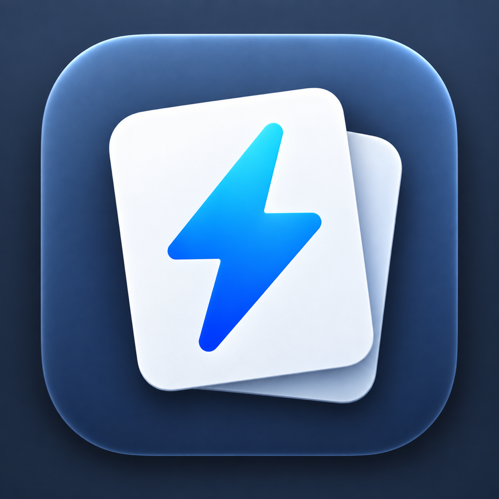

# Flashnote



**가볍고 예쁜, 내 컴퓨터에만 저장되는 문서 노트 앱**

Flashnote는 아이디어, 회의 메모, 공부 기록처럼 **짧은 글**을 쓰는 데 집중한 데스크톱 앱입니다.
앱을 켜면 마지막에 보던 노트가 바로 열리고, 글을 쓰는 동안에는 저장 버튼을 누를 일이 없습니다.
계정도, 클라우드도 없이 노트는 이 Mac 안에만 저장됩니다.

한국어와 영어 UI를 지원합니다. 시스템 언어를 따르고, 설정에서 직접 고를 수도 있습니다.

[English README](README.en.md)

## 이런 점이 좋아요

- **켜면 바로 이어서 씁니다.** 홈 화면, 로그인, 온보딩 없이 마지막에 보던 노트가 열립니다.
- **저장 버튼이 없습니다.** 타이핑하는 동안 알아서 저장합니다.
- **찾기 쉽습니다.** `Cmd+K`로 제목과 본문을 한 번에 검색합니다.
- **구조는 딱 두 단계.** 노트는 최상위에 두거나 폴더 하나에만 들어갑니다.
- **실수해도 되돌릴 수 있습니다.** 지운 노트와 폴더는 휴지통에 남습니다.
- **이미지는 붙여넣기만 하면 됩니다.** 복사한 이미지나 파일을 본문에 그대로 넣을 수 있습니다.
- **백업을 스스로 만듭니다.** 6시간마다 노트와 이미지를 함께 백업하고, 최근 8개를 보관합니다.
- **설정은 조용합니다.** 화면 모드, 글꼴 크기, 언어, 내보내기 정도만 있습니다.

## 일부러 넣지 않은 것

계정, 클라우드 동기화, 협업, 플러그인, AI 기능, 태그·백링크, 탭·분할 화면, 표 편집은 넣지 않았습니다.
기능을 더하는 대신 **켜는 속도, 타이핑 속도, 저장의 안정성**을 지키는 쪽을 택했습니다.
필요가 분명해질 때 하나씩 더하는 게 이 앱의 방향입니다.

## 설치하기 (macOS)

> 아직 공식 배포 전 단계라 App Store나 다운로드 버튼이 없습니다. 아래처럼 **처음 한 번만** 준비하면, 그다음부터는 `Flashnote.command`를 실행해서 켤 수 있습니다.
> 준비에 보통 5~10분, 이후 실행에는 수십 초 정도 걸립니다.
>
> 이 저장소의 실행·패키징 안내는 macOS 기준입니다. 제품 방향에는 Windows도 포함되어 있지만, Windows 설치 경로는 아직 정리되어 있지 않습니다.

### 준비물

- macOS 12 이상
- 인터넷 연결 (첫 준비 때 필요합니다)
- Go 1.27 이상, Node.js 24 이상
- Xcode Command Line Tools (빌드에 필요한 기본 도구)

### 1. Xcode Command Line Tools

터미널을 열고 아래를 실행합니다. 이미 설치되어 있다면 "already installed" 같은 안내가 나옵니다.

```bash
xcode-select --install
```

### 2. Homebrew

이미 쓰고 있다면 건너뛰어도 됩니다. 없다면 아래 한 줄로 설치합니다.

```bash
/bin/bash -c "$(curl -fsSL https://raw.githubusercontent.com/Homebrew/install/HEAD/install.sh)"
```

### 3. Go, Node.js, pnpm 준비

```bash
brew install go node
corepack enable
```

설치가 끝나면 확인해 봅니다.

```bash
go version      # go1.27 이상이면 OK
node --version  # v24 이상이면 OK
```

> `wails3`는 Flashnote가 첫 실행 때 저장소에 맞는 버전으로 자동 설치합니다. 따로 준비하지 않으셔도 됩니다.
> 처음에 pnpm을 내려받아도 되는지 물으면 Enter(Y)를 누르면 됩니다.

### 4. Flashnote 받아서 실행

```bash
git clone https://github.com/savior714/flashnote.git
cd flashnote
./Flashnote.command
```

첫 실행에서는 필요한 도구 설치와 화면 빌드가 함께 진행되어 몇 분 걸릴 수 있습니다.
**앱을 쓰는 동안에는 터미널 창을 그대로 두세요.** 창을 닫으면 앱도 함께 종료됩니다.

두 번째부터는 더 빠르게 켜집니다.

```bash
./Flashnote.command
```

Finder에서 저장소 폴더를 열고 `Flashnote.command`를 더블클릭해도 됩니다.

## 쓰는 법

### 노트 쓰기

- 왼쪽 위 `+` 버튼으로 **새 노트** 또는 **새 폴더**를 만듭니다.
- 제목 칸을 비워 두면 사이드바에 본문 첫 줄이 제목으로 보입니다.
- 본문에서 `/`를 입력하면 문단, 제목 1~3, 글머리·번호·할 일 목록, 인용, 코드 블록, 구분선을 고를 수 있습니다.
- 글자를 선택하면 굵게, 기울임, 취소선, 인라인 코드, 링크 툴바가 뜹니다.
- 이미지는 복사해서 붙여넣거나 파일을 본문으로 끌어다 놓으면 됩니다.
- 폴더는 한 단계만 만들 수 있습니다. 폴더 안에 폴더는 들어가지 않습니다.
- 창을 닫거나 `Cmd+Q`를 누르면 마지막 저장을 마무리한 뒤 종료합니다.

### 단축키

| 하고 싶은 것 | 단축키 |
| --- | --- |
| 새 노트 | `Cmd+N` |
| 노트 검색 | `Cmd+K` |
| 설정 열기 | `Cmd+,` |
| 사이드바 접기·펼치기 | `Cmd+\` |
| 현재 노트를 Markdown으로 내보내기 | `Cmd+Shift+E` |

### 휴지통

- 노트나 폴더를 지우면 휴지통으로 이동합니다. 나중에 **복원**할 수 있습니다.
- 폴더를 지우면 안의 노트도 함께 들어가고, 복원하면 함께 돌아옵니다.
- **휴지통 비우기**나 **영구 삭제**는 되돌릴 수 없습니다.

### 내보내기

- **현재 노트:** `Cmd+Shift+E` → `.md` 파일로 저장합니다. 문서에 넣은 이미지는 옆의 `*.assets` 폴더에 함께 복사됩니다.
- **전체 노트:** `Cmd+,` → **데이터 → 라이브러리 내보내기** → 저장할 폴더를 고르면, 그 안에 새 `Flashnote Export` 폴더를 만들고 모든 노트를 Markdown으로 저장합니다.

## 노트는 어디에 저장되나요?

```
~/Library/Application Support/Flashnote/
├── flashnote.db    노트, 폴더, 휴지통
├── attachments/    문서에 넣은 이미지
└── backups/        자동 백업 (6시간마다, 최근 8개)
```

- 백업에는 데이터베이스와 이미지가 **한 세트로** 들어갑니다.
- 노트를 수동으로 백업하고 싶다면, 앱을 완전히 끈 상태에서 위 폴더를 통째로 복사해 두면 됩니다.
- 데이터 폴더를 iCloud Drive, Dropbox, Google Drive 같은 동기화 폴더로 옮기지 마세요.
  SQLite 데이터베이스와 이미지 파일이 항상 같은 시점으로 움직여야 해서, 일반 파일 동기화는 노트를 깨뜨릴 수 있습니다.
- 계정도 서버도 없으니 노트가 이 Mac 밖으로 자동 전송되는 일은 없습니다.

## 업데이트하기

```bash
cd flashnote
git pull
./Flashnote.command
```

노트와 설정은 그대로 남아 있습니다.

## 다른 Mac에 설치하기 (선택)

내가 쓰는 다른 Mac에 앱으로 설치하고 싶을 때만 필요한 단계입니다. 받는 쪽 Mac에는 Go, Node.js, 소스 저장소가 없어도 됩니다.

빌드하는 Mac에서:

```bash
go install github.com/wailsapp/wails/v3/cmd/wails3@v3.0.0-beta.11
"$(go env GOPATH)/bin/wails3" task --taskfile ./Taskfile.release.yml package:macos:universal:dmg
```

결과물은 `bin/flashnote.dmg`입니다. Apple Silicon과 Intel Mac을 모두 지원하고 macOS 12 이상에서 실행됩니다.
받는 Mac에서 DMG를 열고 `Flashnote.app`을 **Applications** 폴더로 끌어다 놓으면 됩니다.

- 이 빌드는 개인용이라 정식 서명·공증이 되어 있지 않습니다. 처음 열 때 macOS가 막으면 Finder에서 앱을 **Control-클릭 → 열기**로 실행하세요.
- 노트는 앱과 함께 옮겨지지 않습니다. Mac마다 자기 라이브러리를 따로 가집니다(동기화 기능은 아직 없습니다).

## 문제가 생기면

| 증상 | 해결 |
| --- | --- |
| `go: command not found` | `brew install go` 후 터미널을 새로 열어 보세요. |
| `corepack: command not found` | `npm install -g corepack`을 실행하세요. |
| `xcode-select: error` 또는 `clang` 관련 오류 | `xcode-select --install`로 Command Line Tools를 설치하세요. |
| `Flashnote source run requires ...` | 위 준비물 중 빠진 도구가 있다는 뜻입니다. 메시지에 나온 도구를 설치하세요. |
| `Permission denied: ./Flashnote.command` | `chmod +x Flashnote.command`를 한 번 실행하세요. |
| 첫 실행이 멈춘 것처럼 오래 걸림 | 빌드 중인 경우가 많습니다. 터미널의 마지막 줄을 확인하면서 기다려 보세요. |
| 앱 창이 뜨지 않음 | 터미널에 출력된 마지막 오류 메시지를 확인하세요. |
| macOS가 "확인되지 않은 개발자"라고 막음 | 직접 만든 DMG를 처음 열 때만 나옵니다. Control-클릭 → 열기로 실행하세요. |

그래도 해결되지 않으면 [이슈](https://github.com/savior714/flashnote/issues)에 터미널 출력의 마지막 부분과 macOS 버전을 함께 남겨 주세요.

## 개발자용

기술 스택은 Wails v3 + Go, Svelte 5 + TypeScript, Tiptap 3, SQLite입니다.

제품·기술·개발 규칙은 아래 문서가 기준입니다.

- [`docs/PRODUCT.md`](docs/PRODUCT.md) — 제품 동작과 UX 계약
- [`docs/TECHNICAL.md`](docs/TECHNICAL.md) — 구현 구조와 기술 기준
- [`docs/DEVELOPMENT.md`](docs/DEVELOPMENT.md) — 개발·검증·배포 규칙

자주 쓰는 명령:

```bash
# wails3가 없다면 먼저 설치
go install github.com/wailsapp/wails/v3/cmd/wails3@v3.0.0-beta.11

# Go 테스트 + 프런트엔드 타입 검사
wails3 task check

# 코드를 고치면서 자동 반영 (watch 모드)
wails3 dev -config ./build/config.yml
```

- `wails3 dev`는 **코드를 고칠 때만** 쓰세요. 실제 노트를 쓰는 용도로는 `Flashnote.command`를 사용합니다. watch 모드의 재시작은 노트 저장·종료 흐름 밖에서 일어날 수 있습니다.
- UI/네이티브 자동화는 항상 임시 `HOME`에서 실행해 실제 노트 데이터와 분리합니다.
- 의존성을 의도적으로 바꿨다면 `go.sum`과 `frontend/pnpm-lock.yaml`도 함께 커밋하세요.
